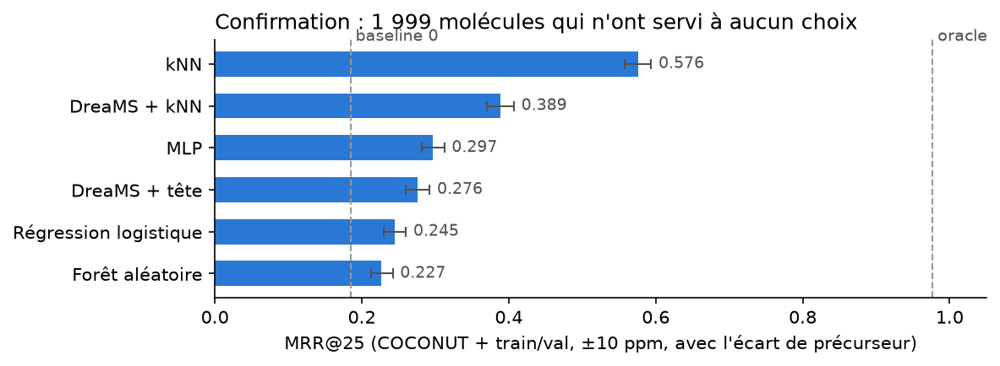

# Identifier des molécules inconnues à partir de leur spectre de masse

Projet de machine learning présenté à l'École d'automne (conférence du 20 novembre 2026) par Fanny, Antonin et Inès. Les données viennent de la compétition Kaggle [Enveda CASMI 2026 – Molecule ID From Mass Spectra](https://www.kaggle.com/competitions/enveda-CASMI26-molecule-id-mass-spectra).

## Le problème

Un spectromètre de masse casse une molécule en fragments et mesure leur masse : on obtient un spectre MS/MS, une liste de pics (m/z, intensité). Pour chaque molécule inconnue, à partir d'un ou plusieurs de ses spectres, il faut proposer 25 structures chimiques classées. Le score est le **MRR@25** : la moyenne de 1/rang de la bonne structure, ou 0 si elle n'est pas dans les 25. Une structure est juste si les 14 premiers caractères de son InChIKey sont les bons : la stéréochimie ne compte pas.

## La démarche

Un classifieur à une classe par molécule ne reconnaîtrait que des molécules déjà vues. On prédit donc l'empreinte de la molécule (un fingerprint de Morgan de 2 048 bits), puis on cherche les structures les plus proches dans un catalogue :

1. **Masse neutre** de la molécule, calculée à partir du précurseur (`precursor_mz`) et de l'adduct.
2. **Candidats** : les structures du catalogue à ±10 ppm de cette masse.
3. **Fingerprint prédit** à partir du spectre : c'est la seule étape apprise.
4. **Classement** des candidats par similarité de Tanimoto avec le fingerprint prédit, corrigée par une feature ajoutée : l'écart entre le précurseur mesuré et le précurseur calculé pour chaque candidat.

Les points clés :

- **Données** : 2 539 608 spectres de 275 810 molécules. Les étiquettes douteuses (adduct illisible, charge opposée au mode, erreur de masse de plus de 0,75 Da) sont écartées de l'entraînement.
- **Validation par molécule** : 10 % des molécules ne sont jamais vues à l'entraînement. Parmi elles, 2 000 molécules `dev` servent à tous les choix, et 2 000 autres molécules `confirmation` ne servent qu'à la note finale, pour un score non optimiste.
- **Catalogue** : COCONUT (479 685 produits naturels) ajouté aux molécules de la compétition, soit 729 385 structures.
- **Cinq familles de modèles** : kNN, régression logistique, MLP, forêt aléatoire, et DreaMS, un modèle pré-entraîné sur des millions de spectres, utilisé tel quel (kNN ou petite tête sur ses vecteurs).
- **En deux temps, pour tenir en moins de 2 h sur un portable sans GPU** : un criblage de toutes les combinaisons d'hyperparamètres de chaque modèle sur 50 000 spectres (32 entraînements), puis le meilleur réglage de chaque modèle réentraîné sur 200 000 spectres et noté sur les molécules `confirmation`.

## Résultats

MRR@25 sur les molécules de confirmation, qui n'ont servi à aucun choix. Le catalogue est celui de COCONUT augmenté des molécules de la compétition, avec les candidats à ±10 ppm. Chaque modèle est pris avec son meilleur réglage du criblage :

| Modèle | Tanimoto seul | Avec l'écart de précurseur | IC 95 % |
|---|---|---|---|
| kNN (cases de 0,01 Da, intensités en log, k = 5) | 0,541 | **0,576** | [0,558 ; 0,594] |
| DreaMS + kNN (k = 5) | 0,343 | 0,389 | [0,371 ; 0,407] |
| MLP (cases de 0,1 Da, racine, adduct en one-hot) | 0,232 | 0,297 | [0,281 ; 0,312] |
| DreaMS + tête MLP | 0,207 | 0,276 | [0,260 ; 0,292] |
| Régression logistique (cases de 0,1 Da, log, adduct décomposé) | 0,173 | 0,245 | [0,230 ; 0,260] |
| Forêt aléatoire (cases de 1 Da, racine) | 0,148 | 0,227 | [0,212 ; 0,242] |
| Baseline 0 : tri par masse, sans regarder le spectre | 0,184 | | [0,172 ; 0,198] |
| Oracle : classement avec le vrai fingerprint | 0,977 | | [0,971 ; 0,983] |



- **Le modèle le plus simple gagne.** Le kNN sur les spectres binés obtient trois fois le score de la baseline 0. Il recopie les fingerprints de vraies molécules proches, alors que les réseaux, entraînés bit par bit, apprennent surtout les bits fréquents.
- **Les réglages qui comptent sont ceux du kNN** : des cases fines, les intensités en log et peu de voisins. Pour les réseaux et la forêt, aucun réglage testé ne change le score de plus de 0,005.
- **La nouvelle feature est le gain le moins cher.** L'écart entre le précurseur mesuré et celui calculé pour chaque candidat apporte de 0,035 à 0,079 selon le modèle, sans réentraîner, et rend inutile d'élargir la tolérance à ±20 ppm.
- **DreaMS, utilisé tel quel, arrive deuxième**, loin devant les réseaux entraînés sur nos spectres.
- **Plus de données aide** : de 50 000 à 200 000 spectres d'entraînement, le kNN passe de 0,427 à 0,531 sur `dev`.
- **Pour une molécule absente du jeu de données, simulée par COCONUT seule, aucun modèle ne dépasse 0,042** : ce catalogue ne contient que 9,6 % de nos molécules.

Le calcul complet prend 77 minutes sur un portable sans GPU, plus le calcul des vecteurs DreaMS sur Google Colab.

## Contenu du dossier

| Fichier | Rôle |
|---|---|
| `casmi_final.ipynb` | Le notebook complet, **exécuté** : toute la démarche, le code et les résultats, lisible directement sur GitHub. |
| `casmi_dreams.ipynb` | Calcul des vecteurs DreaMS, sur Google Colab (GPU gratuit) ou sur un PC. |
| `resultats/` | Les tableaux (CSV) et les graphiques (PNG) du notebook, à lire sans rien exécuter. |
| `externe/coconut.parquet` | COCONUT réduit : une ligne par structure, avec son SMILES et sa masse exacte (28 Mo). |
| `requirements.txt` | Les versions exactes des paquets utilisés. |

## Lire les résultats sans rien installer

Ouvrir `casmi_final.ipynb` sur GitHub : chaque section explique ce qu'elle fait, montre son résultat et le commente dans un paragraphe « Constat ». Les tableaux et les graphiques sont aussi dans `resultats/` :

| Fichier | Contenu |
|---|---|
| `confirmation.png`, `confirmation.csv` | Les scores finaux de chaque modèle sur les molécules de confirmation, avec et sans l'écart de précurseur, sur les deux catalogues. |
| `courbe_loss_mlp.png` | La loss d'entraînement et de validation (spectres `dev`) du MLP final, à chaque époque. |
| `criblage.png`, `criblage.csv` | Le MRR@25 sur `dev` de chacun des réglages du criblage (chaque valeur de k compte pour les kNN). |
| `criblage_meilleurs.csv` | Le meilleur réglage de chaque modèle, et la durée de toute sa grille. |
| `lambda.csv` | L'effet du poids λ de l'écart de précurseur, pour chaque modèle. |
| `ecart_precurseur.png` | L'écart de précurseur de la bonne structure, comparé à celui des autres candidats. |
| `tolerance.csv` | Les scores avec des candidats à ±10 et à ±20 ppm. |
| `rappel_du_filtre.csv` | La part des molécules dont la bonne structure est parmi les candidats, et le nombre de candidats, selon le catalogue et la tolérance. |
| `baseline_oracle_dev.csv` | Le plancher (tri par masse) et le plafond (vrai fingerprint) sur `dev`. |
| `durees.csv` | Le temps d'entraînement de chaque modèle. |
| `spectre_synthetique.png`, `apercu_spectres.png`, `provenance_spectres.png`, `valeurs_manquantes.png`, `erreur_de_masse.png` | L'exploration des données : un spectre synthétique (fabriqué à partir de la distribution des pics, aucun spectre réel), nombre de pics, bibliothèques d'origine, valeurs manquantes, erreurs d'étiquetage. |

## Réexécuter le projet

Les données de la compétition ne sont pas dans ce dépôt : leur licence interdit de les redistribuer (voir plus bas). Il faut un compte Kaggle qui a accepté les règles de la compétition.

1. **Environnement** (Python 3.14) :
   ```bash
   pip install torch==2.15.0 --index-url https://download.pytorch.org/whl/cpu
   pip install -r requirements.txt
   ```
2. **Données**, au choix :
   - télécharger à la main `train.parquet`, `test.parquet` et `sample_submission.csv` depuis l'onglet *Data* de la compétition, et les poser dans `data/raw/` ;
   - ou enregistrer son propre jeton d'API Kaggle dans `~/.kaggle/access_token` : le notebook télécharge alors les données tout seul (environ 3 Go).
3. **Premier passage** : exécuter `casmi_final.ipynb` en entier depuis ce dossier. Comptez environ 1 h 20 sur un portable sans GPU (Intel i5-1135G7, 15 Go de RAM). Sans les vecteurs DreaMS, les modèles DreaMS sont sautés, et la section 8 écrit `data/final/dreams/spectres_dreams.parquet`.
4. **DreaMS** : exécuter `casmi_dreams.ipynb`, sur Google Colab avec un GPU T4 ou sur un PC équipé d'un GPU NVIDIA. Il produit `data/final/dreams/dreams_embeddings.npy`.
5. **Second passage** : réexécuter `casmi_final.ipynb`. Les modèles déjà calculés sont relus sur le disque (`data/final/`) et seuls les modèles DreaMS sont entraînés, en une quinzaine de minutes.

Les graines aléatoires sont fixées : avec les versions de `requirements.txt`, on doit retrouver nos chiffres. Avec d'autres versions ou un autre processeur, de petits écarts restent possibles.

## Données et licences

- **Données de la compétition** : licence CC BY-NC 4.0, réservées aux usages non commerciaux autorisés par le règlement (dont l'enseignement), et à ne pas redistribuer à qui n'a pas accepté les règles. Ni ces données ni aucun fichier calculé à partir d'elles (spectres exportés, vecteurs DreaMS, prédictions) ne sont dans ce dépôt. Le notebook n'affiche aucune ligne brute : seulement des statistiques et des résultats agrégés.
- **COCONUT** : base ouverte de produits naturels, licence CC0, version de novembre 2026 ([coconut.naturalproducts.net](https://coconut.naturalproducts.net)) ; M. Sorokina *et al.*, *Journal of Cheminformatics*, 13, 2, 2021 (PMID 33423696) et V. Chandrasekhar *et al.*, *Nucleic Acids Research*, 53(D1), D634-D643, 2025 (PMID 39588778). `externe/coconut.parquet` en garde l'InChIKey, le SMILES et la masse exacte calculée avec RDKit.
- **DreaMS** : R. Bushuiev *et al.*, « Self-supervised learning of molecular representations from millions of tandem mass spectra using DreaMS », *Nature Biotechnology*, 44(4), 630-640, 2026 (PMID 40410407). Code sous licence MIT, poids sous licence CC BY 4.0 ([github.com/pluskal-lab/DreaMS](https://github.com/pluskal-lab/DreaMS)).

## Limites

- Le score principal est optimiste : le catalogue principal contient toujours la bonne structure, puisqu'il inclut les molécules de la compétition. Seules 9,6 % des molécules `dev` figurent dans COCONUT : pour une molécule absente du jeu de données, simulée par COCONUT seule, aucun modèle ne dépasse 0,042, pour un oracle à 0,077.
- Les requêtes de validation comptent environ 9 spectres en moyenne, contre 3,0 dans le test fourni par Kaggle : leur score est probablement un peu flatteur. Cet effet n'est pas mesuré.
- Les modèles n'apprennent que sur 200 000 des 2,26 millions de spectres d'entraînement, pour tenir sur un portable : des tests précédents, externes au notebook, montraient qu'un kNN gagne nettement avec la base complète.
- DreaMS est utilisé sans réentraînement (vecteurs figés), et calculé sur un GPU extérieur.
